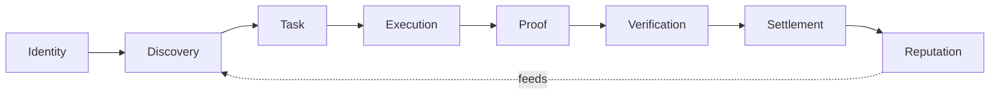
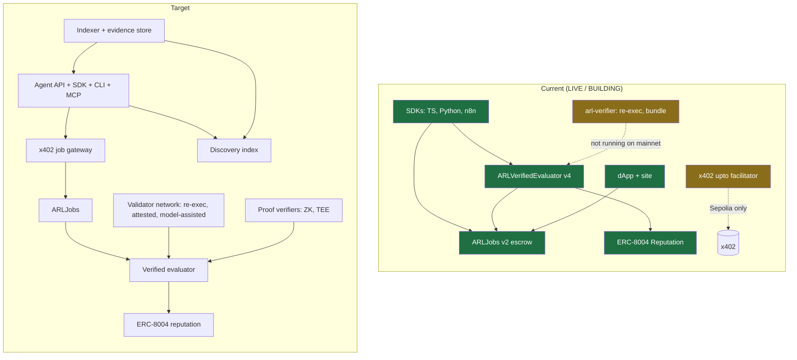
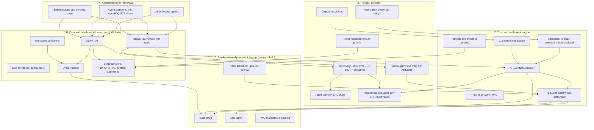
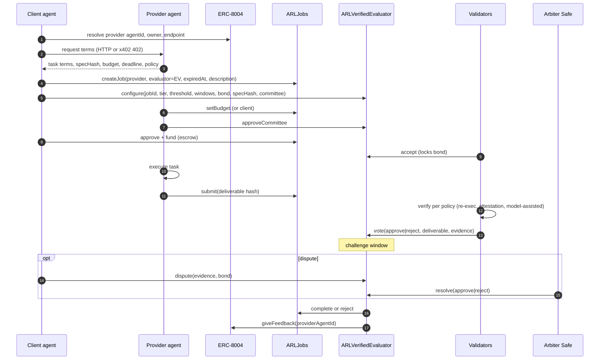
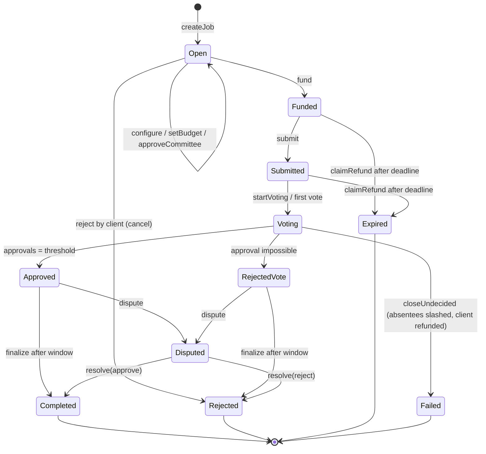
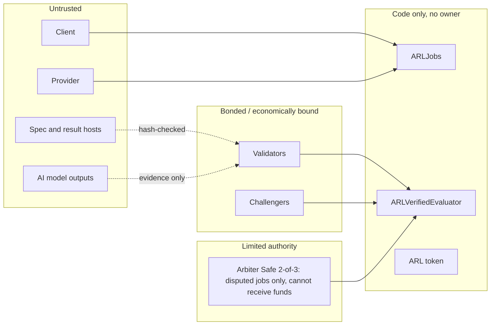
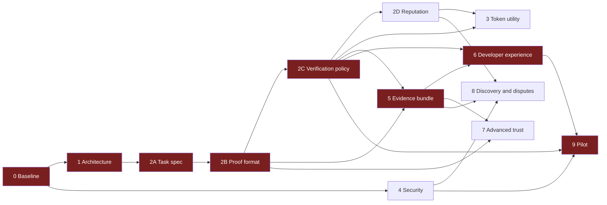

# ARL Protocol: Master Architecture and Development Roadmap

Status: **proposal for review**, 14 November 2026. This document plans work; it implements
nothing. It was written after reading the repository at `main` (`b63a7b0`). Every status below
cites the evidence it rests on. Where the evidence is not in the repository, the item is marked
**UNVERIFIED**.

Status labels:

| Label      | Meaning                                                                               |
| ---------- | ------------------------------------------------------------------------------------- |
| LIVE       | Deployed and checked: on Base Mainnet with a deployment record, or online and serving |
| BUILDING   | Code and tests exist in the repository; not deployed or not operated in production    |
| PLANNED    | Designed or documented; no implementation in the repository                           |
| UNVERIFIED | Claimed or likely, but the repository holds no evidence that confirms it              |

---

## 1. Executive summary

ARL Protocol is trust infrastructure for autonomous AI agents on Base. The core of the protocol
already exists and is deployed: an ERC-8183 jobs escrow (`ARLJobs`, paid in ARL and in USDC) and a
verified evaluator (`ARLVerifiedEvaluator`) in which a committee of staked validators approves or
rejects work, with a challenge window, disputes ruled by a 2-of-3 arbiter Safe, and outcomes
written to the canonical ERC-8004 reputation registry. A reference validator (`arl-verifier`)
re-executes deterministic jobs from a hashed spec (`arl-reexec/1`) and can export a portable
evidence bundle (`arl-evidence/1`). SDKs for TypeScript, Python and n8n are published.

What is missing is not the settlement core but everything around it that makes it usable at
scale: a standard task and proof format beyond deterministic re-execution, running validators on
mainnet, a verification path for non-deterministic AI output, discovery, a dispute process that
does not depend on three signers, and real usage. On Base Mainnet, the ARL escrow had **no jobs**
when this document was written (`jobCounter() = 0`, read on 2026-11-13).

The roadmap therefore keeps the deployed contracts unchanged for as long as possible and builds
off-chain: specifications first (task, proof, verification policy, reputation), then the services
that implement them (validators, indexer, evidence store, API), then a controlled pilot. Contract
changes are concentrated in two places that the existing design already anticipates: the x402 job
gateway (`ARLX402JobGateway`, designed) and proof-backed dispute resolution (`IExecutionVerifier`,
designed).

Open AI models, with NVIDIA Nemotron as the first candidate, enter as **off-chain tools for
validators and providers**: drafting task specs, checking deliverables against acceptance criteria
and triaging disputes. A model output is evidence that staked validators vote on. It never moves
money by itself (principle 6.4).

## 2. Project vision and protocol objectives

Vision: any AI agent can hire another agent or service, pay only for work that is delivered and
checked, and carry a reputation that others can verify.

Core flow:

| Objective                    | Protocol capability                                  | Primary component                                  |
| ---------------------------- | ---------------------------------------------------- | -------------------------------------------------- |
| Verifiable identity          | Agent identity and ownership                         | ERC-8004 IdentityRegistry (canonical, not ARL's)   |
| Discovery                    | Find agents and services with terms and track record | Discovery index (off-chain) over ERC-8004          |
| Create, accept, execute task | Standard task terms, lifecycle                       | Task spec + `ARLJobs`                              |
| Secure payment               | Escrow with deadline and refund                      | `ARLJobs` (ERC-8183)                               |
| Proof of completion          | Hash-committed deliverable plus evidence             | Proof envelope + `ARLJobs.submit`                  |
| Verified outcome             | Policy-driven checks, staked votes, challenge window | `ARLVerifiedEvaluator` + validators                |
| Reputation                   | Outcome-derived, tamper-resistant scores             | ERC-8004 ReputationRegistry, evaluator-only reads  |
| Disputes                     | Challenge, ruling, slashing                          | `ARLVerifiedEvaluator.dispute/resolve`, arbiter    |
| Developer interfaces         | SDK, API, CLI, no-code                               | `packages/sdk`, `python-sdk`, `n8n-nodes-arl`, CLI |

## 3. Existing system assessment

Evidence sources: `docs/baseline.md` (31 October 2026), `docs/mainnet-services.md`,
`contracts/deploy/base-mainnet-jobs.json`, `contracts/deploy/base-mainnet-services.json`,
`docs/verifiable-execution.md`, `docs/reexecution-spec.md`, `spec/`, package sources, and chain
reads made during this session.

### 3.1 Smart contracts (`contracts/src`)

| Contract               | Purpose                                                                     | Status (Base Mainnet)                                                    | Evidence                                                |
| ---------------------- | --------------------------------------------------------------------------- | ------------------------------------------------------------------------ | ------------------------------------------------------- |
| `ARLToken`             | ERC-20, 21,000,000 fixed supply, permit, no owner                           | LIVE `0xde91…aDb4`                                                       | baseline; bytecode matches tag `v1.0.0-release-00d9056` |
| `ARLVestingWallet`     | Investor and partnership vesting                                            | LIVE                                                                     | `docs/mainnet-plan.md`                                  |
| `ARLTimelock`          | Treasury timelock with cancel-only guardian                                 | LIVE                                                                     | `docs/mainnet-plan.md`                                  |
| `ARLJobs`              | ERC-8183 escrow: Open → Funded → Submitted → Completed / Rejected / Expired | LIVE (v2) `0x4664…98f9` ARL, `0xc833…5bE6` USDC                          | `base-mainnet-jobs.json`; jobs-record 9/9 checks        |
| `ARLJobs` (repo, v3)   | Adds balance-delta check on `fund` and `claimRefundTo`                      | BUILDING: merged in `main` (#153), **not deployed**; mainnet runs v2     | `git log` #153; deployed nonce 25 predates it           |
| `ARLVerifiedEvaluator` | Staked committee votes, challenge window, disputes, arbiter, ERC-8004 write | LIVE v4 `0x5cA6…7DfF` ARL, `0x8C01…0CFC` USDC                            | `docs/mainnet-services.md` nonces 29, 30                |
| `ComputePayment`       | Per-second compute streams paid in ARL                                      | LIVE `0x1bFE…E464`                                                       | nonce 31, 10/10 checks                                  |
| `ARLStakingRewards`    | ARL staking with reward periods                                             | BUILDING on mainnet: deployed `0x15e2…a102`, **first period not funded** | nonce 32; `docs/mainnet-services.md` step 4             |
| `ARLAnonymousSignal`   | Semaphore-style anonymous signals (Noir/UltraHonk)                          | BUILDING: local chain only                                               | `docs/zk-privacy.md`                                    |
| `ARLMerkleDistributor` | Merkle claims                                                               | BUILDING: not deployed at TGE                                            | `docs/architecture.md`                                  |
| `ARLAllocation`        | Allocation helper                                                           | UNVERIFIED (role in production not documented in the files read)         | —                                                       |
| `ARLX402JobGateway`    | One x402 signature opens and funds a verified job                           | PLANNED (interface in `docs/verifiable-execution.md`, no source)         | design only                                             |
| `IExecutionVerifier`   | Proof-backed approval and dispute resolution                                | PLANNED                                                                  | design only                                             |

Usage on mainnet: the ARL escrow's `jobCounter()` returned `0` on 2026-11-13. No validators are
staked on mainnet (`docs/mainnet-services.md` step 2: "Not started"). The verified flow is
deployed but **has not been exercised on mainnet**.

### 3.2 Off-chain packages and services

| Component                               | Purpose                                                                                     | Status                                                                                   | Evidence                                    |
| --------------------------------------- | ------------------------------------------------------------------------------------------- | ---------------------------------------------------------------------------------------- | ------------------------------------------- |
| `packages/verifier` (`arl-verifier`)    | Reference validator: `run`, `watch`, `bundle`, `verify-bundle`; `arl-reexec/1` re-execution | BUILDING: tests pass (unit, container, Anvil); **no validator runs on mainnet**          | `docs/reexecution-spec.md`, baseline        |
| Evidence bundle `arl-evidence/1`        | Portable settlement evidence, verifiable offline and against chain                          | BUILDING                                                                                 | `packages/verifier/src/bundle.ts`           |
| `packages/payments`                     | x402 `upto` (Permit2) facilitator, metering, receipts                                       | BUILDING: Base Sepolia only, **does not open 8453**                                      | `docs/payments.md`                          |
| `spec/x402-arl-upto` v0.1.0             | x402 `upto` scheme for ARL with test vectors                                                | BUILDING (spec released, facilitator not on mainnet)                                     | `spec/x402-arl-upto/v0.1.0`                 |
| `spec/x402-arl-escrow` v0.2.0           | x402 `arl-escrow` scheme: 402 terms → verified job                                          | PLANNED (draft for review, 2026-10-24)                                                   | `spec/x402-arl-escrow/v0.2.0-draft/flow.md` |
| `packages/provider`                     | Reference compute provider settling seconds used                                            | BUILDING                                                                                 | `docs/compute-provider.md`                  |
| `packages/sdk` (`arl-protocol-sdk`)     | Jobs, verified jobs, `payVerified`, compute streams, `acquireArl`                           | LIVE on npm (0.1.0); jobs functions tested on a mainnet fork                             | npm; `packages/sdk`                         |
| `packages/python-sdk` (`arl_protocol`)  | Jobs in Python                                                                              | LIVE as a source install from GitHub; not on PyPI                                        | PR #158                                     |
| `packages/n8n-nodes-arl`                | n8n node for jobs                                                                           | LIVE on npm (0.1.0); n8n Cloud verification pending                                      | npm; PR #156                                |
| `apps/dapp` (`arlcoin.io/app`)          | Wallet, trade, vesting, staking, jobs, verified jobs, network                               | LIVE on Base Mainnet; Payments and Private screens show "not live"                       | site answers 200; `apps/dapp/app/*`         |
| `apps/web` (`arlcoin.io`)               | Site and developer page `/build`                                                            | LIVE                                                                                     | Cloudflare Pages                            |
| `functions/api` (`supply`, `whitelist`) | Supply API, whitelist intake                                                                | LIVE                                                                                     | baseline                                    |
| `packages/telegram-bot`                 | Community bot                                                                               | LIVE (Cloudflare Worker)                                                                 | PR #151                                     |
| Event indexer                           | Indexed jobs, votes, outcomes                                                               | PLANNED: the app reads logs directly (`apps/dapp/lib/logs.ts`)                           | no indexer in repo                          |
| Evidence storage                        | Specs and results by URI (IPFS/HTTPS)                                                       | PLANNED: specs are fetched from URIs; no ARL-operated store                              | `docs/reexecution-spec.md`                  |
| Public API for agents                   | REST/JSON API over jobs, discovery, evidence                                                | PLANNED                                                                                  | none                                        |
| Monitoring                              | Uptime of the site; contract monitor CLI                                                    | BUILDING: `uptime.yml`, `packages/deploy/src/monitor.ts`; no alerting on protocol events | `.github/workflows/uptime.yml`              |

### 3.3 External dependencies

| Dependency                       | Used for                                | Status                                                            |
| -------------------------------- | --------------------------------------- | ----------------------------------------------------------------- |
| Base (8453)                      | Settlement chain                        | LIVE                                                              |
| ERC-8004 Identity and Reputation | Agent identity, outcome feedback        | LIVE (canonical registries; evaluator writes feedback, app reads) |
| ERC-8183                         | Escrowed job interface                  | LIVE (implemented by `ARLJobs`)                                   |
| x402 (Coinbase)                  | HTTP 402 payment negotiation            | BUILDING in ARL (`upto` on Sepolia; `arl-escrow` draft)           |
| Permit2, EIP-3009                | Signature-based token transfers         | BUILDING (payments package)                                       |
| Safe v1.5.0                      | Arbiter, allocation custody             | LIVE                                                              |
| Uniswap v3                       | ARL liquidity (USDC, USDT, WETH, cbBTC) | LIVE                                                              |
| Noir / UltraHonk, Semaphore      | Anonymous signals, future proofs        | BUILDING (local only)                                             |
| AP2 (agent payments protocol)    | Mandate-based agent payments            | PLANNED: not referenced anywhere in the repository                |
| PACT                             | Named in the brief as proof of delivery | UNVERIFIED: no definition in the repository (see decision D-3)    |
| NVIDIA Nemotron open models      | Off-chain checking and triage           | PLANNED: not referenced in the repository                         |

## 4. Current vs target architecture

| Area          | Current                                           | Target                                                           | Gap                            |
| ------------- | ------------------------------------------------- | ---------------------------------------------------------------- | ------------------------------ |
| Task          | Free-text description; `arl-reexec/1` for code    | `arl-task/1`: typed task terms covering several workload classes | Spec (Phase 2A)                |
| Proof         | `bytes32` deliverable hash; `arl-reexec-result/1` | `arl-proof/1` envelope: deliverable, evidence, attestations      | Spec (Phase 2B)                |
| Verification  | Re-execution tier only has a reference validator  | Policy per task class: re-exec, attested, model-assisted, proof  | Policy + validators (2C, 9)    |
| Validators    | None on mainnet                                   | Operator-run first, then open staked set                         | Operations, incentives (3, 9)  |
| Payment entry | Direct contract calls                             | Also x402 `arl-escrow` via a gateway                             | Gateway contract, spec release |
| Disputes      | Arbiter Safe, 2 of 3                              | Proof-resolved where possible; timelocked arbiter otherwise      | Phase 8, Phase 7               |
| Discovery     | dApp Network screen reads ERC-8004 services       | Indexed discovery with terms and verified scores                 | Indexer, API (6, 8)            |
| Observability | Uptime check                                      | Protocol event alerts, validator liveness, public stats          | Phase 4, 6                     |

## 5. Complete logical architecture

### Open models in the architecture (NVIDIA Nemotron first)

The brief asks for active use of open-source components and NVIDIA Nemotron models. The safe place
for a language model in a settlement protocol is **off-chain, as a tool whose output is evidence**:

| Use                | Who runs it       | Input                                         | Output                                    | Settles money?                       |
| ------------------ | ----------------- | --------------------------------------------- | ----------------------------------------- | ------------------------------------ |
| Task spec drafting | Client SDK / API  | Natural-language request                      | Draft `arl-task/1`, shown to the client   | No: the client signs the terms       |
| Acceptance check   | Validators        | Task acceptance criteria, deliverable         | Structured verdict + rationale (evidence) | No: validators vote, can be disputed |
| Dispute triage     | Arbiter tooling   | Dispute evidence bundle                       | Summary and checklist for signers         | No: the arbiter rules                |
| Discovery matching | Discovery service | Task terms, agent profiles, verified outcomes | Ranked candidates                         | No                                   |

Rules: the model and its weights are pinned by hash and named in the task's verification policy;
inference runs on the validator's own hardware or inside an attested enclave (`Attested` tier,
including NVIDIA confidential-computing GPUs, an open question already listed in
`docs/verifiable-execution.md`); prompts and outputs go into the evidence bundle; a model verdict
is never sufficient on its own for jobs above a policy-defined budget. The exact Nemotron
checkpoint, its license terms and hardware requirements are **UNVERIFIED** and are a Phase 1
decision (D-6).

## 6. Component responsibilities and dependencies

On-chain components are marked ⛓; off-chain components are marked ☁.

### A. Application layer

| Component           | Responsibility                       | Inputs → outputs              | Depends on             | Chain | Trust boundary                                    | Status              |
| ------------------- | ------------------------------------ | ----------------------------- | ---------------------- | ----- | ------------------------------------------------- | ------------------- |
| Autonomous agents   | Create, fund, execute and judge work | Intents → signed transactions | SDK/API, wallet        | ☁     | Holds its own keys; untrusted by the protocol     | external            |
| Agent platforms     | Package ARL for their users          | Workflows → SDK calls         | n8n node, SDK, MCP     | ☁     | Platform credentials scoped to a dedicated wallet | BUILDING (n8n LIVE) |
| External apps, dApp | Human interfaces                     | User actions → transactions   | SDK, wallet connectors | ☁     | Never holds user keys                             | LIVE (dApp)         |

### B. Protocol services

| Component           | Responsibility                                                   | Inputs → outputs                                | Depends on                   | Chain           | Trust boundary                                                       | Status                                        |
| ------------------- | ---------------------------------------------------------------- | ----------------------------------------------- | ---------------------------- | --------------- | -------------------------------------------------------------------- | --------------------------------------------- |
| Agent identity      | Bind an agent to an owner and endpoints                          | Registration → agentId                          | ERC-8004 IdentityRegistry    | ⛓               | Canonical registry; ARL does not own it                              | LIVE (external)                               |
| Task registry       | Hold terms, budget, deadline, parties, status                    | createJob/setBudget/fund/submit → events, state | `ARLJobs`                    | ⛓               | Code only, no owner                                                  | LIVE                                          |
| Discovery           | Find agents/services by capability, terms and verified score     | Query → ranked list                             | Indexer, ERC-8004, outcomes  | ☁               | Ranking is advisory; outcomes are re-checkable on chain              | BUILDING (dApp Network screen), index PLANNED |
| Proof management    | Define and store proof envelopes; bind them to the on-chain hash | Deliverable + evidence → `arl-proof/1`, hash    | Evidence store               | ☁ + ⛓ hash      | Only the hash is trusted on chain; content is checked against it     | BUILDING (`arl-reexec-result/1`)              |
| Verification policy | Map a task class to a method, committee shape and thresholds     | Task terms → policy id, checks                  | Validators, evaluator config | ☁ (+ ⛓ config)  | Contract enforces committee shape and windows; policy text off-chain | PLANNED (`arl-policy/1`)                      |
| Reputation          | Turn verified outcomes into scores                               | Evaluator feedback → score                      | ERC-8004 ReputationRegistry  | ⛓ write, ☁ read | Only feedback from the deployed evaluator counts (allowlisted read)  | LIVE (write path), scoring PLANNED            |
| Dispute resolution  | Challenge, rule, slash                                           | Dispute + bond → ruling                         | Evaluator, arbiter Safe      | ⛓               | Arbiter majority for disputed jobs only; cannot take funds           | LIVE (contract), process PLANNED              |

### C. Trust and settlement engine

| Component                | Responsibility                                                                  | Inputs → outputs                                   | Depends on                    | Chain               | Trust boundary                                                   | Status                                   |
| ------------------------ | ------------------------------------------------------------------------------- | -------------------------------------------------- | ----------------------------- | ------------------- | ---------------------------------------------------------------- | ---------------------------------------- |
| Proof of delivery (PACT) | Name and package "delivered as agreed": terms hash + deliverable hash + verdict | Task, proof, verdict → delivery record             | Task spec, proof, evaluator   | ☁ record, ⛓ anchors | Delivery is never inferred from payment or from submission alone | UNVERIFIED term; PLANNED as a spec (D-3) |
| `ARLJobs` escrow         | Lock budget; pay provider or refund client; deadline refund                     | fund/complete/reject/claimRefund → transfers       | ARL or USDC                   | ⛓                   | No owner, no upgrade                                             | LIVE (v2)                                |
| `ARLVerifiedEvaluator`   | Run committee vote, challenge window, finalize, write reputation                | configure/accept/vote/dispute/finalize → decisions | `ARLJobs`, ERC-8004, arbiter  | ⛓                   | Code only; arbiter limited to disputed jobs                      | LIVE (v4)                                |
| Validators               | Check deliverables per policy and vote                                          | Spec, deliverable → vote, evidence hash            | Stake, `arl-verifier`, models | ☁ (votes ⛓)         | Any single validator untrusted; bonded and slashable             | BUILDING (none on mainnet)               |
| Challenge and dispute    | Let anyone contest a decision within the window                                 | Evidence + bond → ruling                           | Evaluator, arbiter            | ⛓                   | Requires inclusion within the window on Base                     | LIVE (contract)                          |
| Payment receipts         | Signed usage receipts (x402 upto); settlement evidence bundles                  | Metering → receipt; chain → `arl-evidence/1`       | Payments, verifier            | ☁                   | Receipts are signed claims, bundles are re-checkable             | BUILDING                                 |

### D. Blockchain and payment infrastructure

| Component         | Responsibility                          | Status                                             |
| ----------------- | --------------------------------------- | -------------------------------------------------- |
| Base              | Execution, finality, forced inclusion   | LIVE                                               |
| ARL token         | Escrow currency, stakes and bonds, fees | LIVE                                               |
| x402 `upto`       | Metered per-use payments                | BUILDING (Sepolia only)                            |
| x402 `arl-escrow` | 402 terms that open a verified job      | PLANNED (draft spec; gateway contract designed)    |
| AP2               | Agent payment mandates                  | PLANNED, only if a pilot partner requires it (D-5) |

### E. Data and developer infrastructure

| Component        | Responsibility                                 | Status                                                  |
| ---------------- | ---------------------------------------------- | ------------------------------------------------------- |
| Event indexer    | Index `ARLJobs` and evaluator events, outcomes | PLANNED (the dApp reads logs directly, 50k-block spans) |
| Evidence store   | Content-addressed specs, results, bundles      | PLANNED                                                 |
| Backend services | Facilitator, validator runners, indexer, API   | BUILDING (facilitator, validator code), others PLANNED  |
| API              | Read API for agents and discovery              | PLANNED                                                 |
| SDK              | TS, Python, n8n                                | LIVE                                                    |
| CLI              | `arl-verifier`, deploy and record tools        | BUILDING                                                |
| Monitoring       | Uptime, contract records, alerts               | BUILDING (uptime, record CLIs); protocol alerts PLANNED |

## 7. End-to-end protocol lifecycle

### 7.1 Steps, owners and authorization

| #   | Step                         | Responsible            | Authorization (enforced by)                                                  | Output                         |
| --- | ---------------------------- | ---------------------- | ---------------------------------------------------------------------------- | ------------------------------ |
| 1   | Identity verification        | Client (reads)         | ERC-8004 ownership of `agentId`                                              | Provider identity, owner       |
| 2   | Discovery and selection      | Client / discovery svc | None on chain; advisory                                                      | Chosen provider, terms         |
| 3   | Task creation, acceptance    | Client, provider       | `createJob` by client; `setBudget` by either; `approveCommittee` by provider | Job Open, configured           |
| 4   | Terms and payment conditions | Client, provider       | `configure` only by client while Open; bounds on windows, bond               | Policy fixed on chain          |
| 5   | Escrow funding               | Client                 | `fund` only by client, exact budget, before expiry                           | Job Funded                     |
| 6   | Execution                    | Provider               | Off-chain                                                                    | Result, evidence               |
| 7   | Proof submission             | Provider               | `submit` only by provider, Funded, before expiry                             | Job Submitted, hash on chain   |
| 8   | Proof verification           | Validators             | Only accepted committee members vote, once each                              | Approved / Rejected / Failed   |
| 9   | Evaluator or dispute         | Anyone, arbiter        | `dispute` by anyone with bond in window; `resolve` arbiter, disputed only    | Ruling, slashing               |
| 10  | Settlement or refund         | Anyone                 | `finalize` after window; `claimRefund` + `release` after deadline            | Completed / Rejected / Expired |
| 11  | Reputation update            | Evaluator (automatic)  | Gas-capped call; failure never blocks settlement                             | ERC-8004 feedback              |

Proof submission (step 7) only records a hash. Proof verification (step 8) is the committee's
decision. Final settlement (step 10) happens only after the challenge window. Payment is never
treated as proof of execution, and a submitted proof is never treated as verified.

### 7.2 States

### 7.3 Failure scenarios

| Failure                          | Handling today                                              | Gap / roadmap                                     |
| -------------------------------- | ----------------------------------------------------------- | ------------------------------------------------- |
| Provider never delivers          | Deadline refund by anyone (`claimRefund`, `release`)        | Reputation penalty for no-shows (2D)              |
| Validators accept and never vote | `closeUndecided` burns their bonds, refunds client          | Validator liveness alerts (4, 6)                  |
| No validators available          | Job cannot be verified; deadline refund                     | Operator-run validator set (9), VRF selection (8) |
| Wrong approval                   | Dispute within window; arbiter overturns, approvers slashed | Proof-resolved disputes (7)                       |
| Arbiter unavailable              | Deadline backstop refunds client                            | Timelocked arbiter, proof resolution (8, 7)       |
| Registry failure                 | Feedback failure emitted, settlement continues              | —                                                 |
| Non-deterministic output (LLM)   | Not supported by `Reexecution`                              | Attested and model-assisted policies (2C, 7)      |
| Fee-on-transfer or odd tokens    | v3 balance-delta check merged, **not deployed**             | Decide redeploy in Phase 4                        |

## 8. On-chain vs off-chain responsibilities

| Concern      | On-chain (Base)                                       | Off-chain                                              |
| ------------ | ----------------------------------------------------- | ------------------------------------------------------ |
| Money        | All custody, payout, refund, slashing                 | Never                                                  |
| Task terms   | Hashes, budget, deadline, parties, committee, windows | Full spec text, acceptance criteria                    |
| Proof        | Deliverable hash, evidence hash in votes              | Deliverable content, logs, attestations, model output  |
| Verification | Vote counting, thresholds, windows, dispute state     | The actual checking (re-execution, models, TEE checks) |
| Reputation   | Feedback records from the evaluator                   | Score computation, ranking                             |
| Discovery    | Identity records                                      | Search, matching, ranking                              |
| Evidence     | Anchors (hashes, tx references)                       | Bundles, storage, retrieval                            |

Gas principle: one transaction per state change that moves money or fixes a commitment; nothing
that can be recomputed from events is stored twice.

## 9. Security and trust boundaries

| Boundary             | Trusted for                                    | Not trusted for           | Requirement                                                                                   |
| -------------------- | ---------------------------------------------- | ------------------------- | --------------------------------------------------------------------------------------------- |
| Contracts (no owner) | Correct execution of code                      | —                         | Audit status must be stated; the auditor's confirmation of the 2026-10-28 fixes is UNVERIFIED |
| Validators           | `threshold` honest among an approved committee | Any single validator      | Bond ≥ budget / 10; SDK should refuse `threshold × bond < budget`                             |
| Arbiter Safe         | Majority rules disputed jobs correctly         | Undisputed jobs, custody  | Separate hardware wallets; plan to timelock then retire                                       |
| Off-chain content    | Nothing; only hashes on chain are trusted      | Availability, truth       | Content-addressed storage; hash checks everywhere                                             |
| AI models            | Nothing by themselves                          | Verdicts                  | Pinned weights hash; outputs in evidence; human/bonded vote decides                           |
| Deployer key         | Creating contracts                             | Anything after deployment | Single signer today (baseline risk 3); move to a deployer Safe                                |
| Base sequencer       | Inclusion within the challenge window          | —                         | Mainnet challenge window ≥ 24 h                                                               |

## 10. Complete Phase 0–9 development roadmap

Each phase lists objective, scope, prerequisites, deliverables, dependencies, risks, acceptance
criteria and the gate to the next phase. Deliverables are documents or code reviewed through pull
requests; no phase changes a deployed contract unless it says so explicitly.

### Phase 0: Baseline

- **Objective:** a dated, evidence-backed record of what exists, refreshing `docs/baseline.md`.
- **Scope:** contracts, deployments, integrations, tests, CI, packages, operational accounts.
- **Prerequisites:** none.
- **Deliverables:** updated baseline table with LIVE/BUILDING/PLANNED/UNVERIFIED per item;
  on-chain reads of every mainnet contract (code hash vs `bytecode.json`, `jobCounter`, stakes);
  test run log (`forge test`, package tests); list of deployed vs repository contract versions
  (ARLJobs v2 vs v3).
- **Dependencies:** none.
- **Risks:** stale records; confusing repository code with deployed code.
- **Acceptance:** every LIVE claim has an address and a check command; zero items without a label.
- **Gate:** owner signs off the baseline.

### Phase 1: Architecture

- **Objective:** approve this architecture and resolve decisions D-1 to D-8 (section 12).
- **Scope:** component boundaries, data flows, trust boundaries, Nemotron and open-model usage.
- **Prerequisites:** Phase 0.
- **Deliverables:** this document approved; decision records appended; chosen open model with
  license review and hardware plan.
- **Dependencies:** Phase 0.
- **Risks:** scope creep into implementation; unclear PACT definition.
- **Acceptance:** each decision has an owner choice and date; no component without an owner.
- **Gate:** owner approval.

### Phase 2A: Task specification (`arl-task/1`)

- **Objective:** one task format for all workload classes, compatible with `arl-reexec/1`.
- **Scope:** fields (parties, terms, budget, deadline, workload class, inputs by hash, acceptance
  criteria, verification policy id, evidence requirements), canonical hashing, versioning.
- **Prerequisites:** Phase 1.
- **Deliverables:** spec under `spec/arl-task/v0.1.0` with JSON schema and test vectors; mapping
  to `ARLJobs.createJob` and `configure` fields; SDK validation plan.
- **Dependencies:** 1.
- **Risks:** over-general spec; breaking `arl-reexec/1`.
- **Acceptance:** `arl-reexec/1` specs are valid `arl-task/1` documents; vectors hash identically
  in TS and Python.
- **Gate:** reviewed spec merged.

### Phase 2B: Proof format (`arl-proof/1`)

- **Objective:** a standard proof envelope.
- **Scope:** deliverable reference and hash, evidence items (logs, outputs, attestations, model
  verdicts with model hash), signatures, binding to `specHash` and `jobId`.
- **Prerequisites:** 2A.
- **Deliverables:** spec with schema and vectors; how `deliverable` and vote `evidence` hashes are
  derived; compatibility with `arl-reexec-result/1`.
- **Dependencies:** 2A.
- **Risks:** proofs that cannot be checked; large evidence on chain (forbidden: hashes only).
- **Acceptance:** an existing re-exec result converts losslessly; hash binding tested.
- **Gate:** reviewed spec merged.

### Phase 2C: Verification policy (`arl-policy/1`)

- **Objective:** explicit rules per workload class.
- **Scope:** method (re-execution, attested, model-assisted, proof), committee size and threshold,
  bond sizing (`threshold × bond ≥ budget`), windows, acceptance and rejection conditions,
  challenge triggers, when a model verdict is admissible and its budget cap.
- **Prerequisites:** 2A, 2B.
- **Deliverables:** policy spec; policy table for the pilot workloads; validator decision
  procedure; Nemotron-assisted check procedure with pinned model hash.
- **Dependencies:** 2A, 2B.
- **Risks:** policies the contract cannot enforce (keep enforcement in contract bounds, the rest
  in validator duty plus disputes).
- **Acceptance:** every policy maps to a valid `configure` call; worked examples for each method.
- **Gate:** reviewed spec merged.

### Phase 2D: Reputation writeback

- **Objective:** scores that only reflect verified outcomes.
- **Scope:** what the evaluator writes (already: outcome feedback for `providerAgentId`), how scores
  are read (evaluator-allowlisted `getSummary`), weighting by budget and recency, penalties for
  expiry and failed votes, validator reputation.
- **Prerequisites:** 2C.
- **Deliverables:** reputation spec; scoring function with vectors; anti-manipulation analysis
  (self-dealing jobs, wash jobs).
- **Dependencies:** 2C.
- **Risks:** wash trading for reputation; cost of self-dealing too low.
- **Acceptance:** fake third-party feedback is ignored (already tested on a fork); wash-job cost
  model documented.
- **Gate:** reviewed spec merged.

### Phase 3: Token utility

- **Objective:** sustainable economics around existing contracts.
- **Scope:** ARL as escrow currency, validator stake and bonds (`stakeToken` = escrow token),
  validator fees (designed, not built), staking rewards program, fee sinks, USDC jobs with ARL
  validator stakes question (open question 1 in `verifiable-execution.md`).
- **Prerequisites:** 2C, 2D.
- **Deliverables:** economic spec using `packages/tokenomics` as the only source of allocation
  numbers; validator fee model; reward budget for the first staking period.
- **Dependencies:** 2C, 2D.
- **Risks:** incentives that reward volume over correctness; regulatory framing of rewards.
- **Acceptance:** simulations show honest validation is the dominant strategy at pilot volumes.
- **Gate:** owner approval.

### Phase 4: Security hardening

- **Objective:** close known risks before real value flows.
- **Scope:** close the audit loop for the 2026-10-28 fixes; decide on ARLJobs v3 redeploy;
  deployer key to a Safe; arbiter operations runbook; threat model refresh (section 9);
  monitoring and alerting on protocol events; incident response drill.
- **Prerequisites:** Phase 0; can start in parallel with Phase 2.
- **Deliverables:** independent audit report (or the auditor's confirmation); redeploy decision
  record; alert rules; drill report.
- **Dependencies:** 0 (and 3 for economic attacks).
- **Risks:** redeploy fragmenting state; audit cost.
- **Acceptance:** no open high or medium finding; alerts fire in a test.
- **Gate:** security sign-off before the pilot.

### Phase 5: Evidence bundle

- **Objective:** a portable, independently verifiable package per task.
- **Scope:** extend `arl-evidence/1` with `arl-task/1`, `arl-proof/1` and policy references;
  content-addressed storage; offline and on-chain verification.
- **Prerequisites:** 2A–2C.
- **Deliverables:** `arl-evidence/2` spec; verifier support plan; storage choice (D-7).
- **Dependencies:** 2A–2C.
- **Risks:** privacy of evidence; storage availability.
- **Acceptance:** a third party verifies a pilot job's bundle with only the bundle and an RPC.
- **Gate:** reviewed spec merged.

### Phase 6: Developer experience

- **Objective:** integration in minutes for agents, platforms and institutions.
- **Scope:** SDK support for the new specs; read API and indexer; CLI; MCP server; Coinbase
  AgentKit action provider; PyPI release; x402 `arl-escrow` spec release and gateway design
  review; docs on `/build`.
- **Prerequisites:** 2A–2C (APIs follow specs), 5 for evidence endpoints.
- **Deliverables:** API specification; SDK changes plan; integration guides.
- **Dependencies:** 2A–2C, 5.
- **Risks:** breaking published SDK APIs (semver required).
- **Acceptance:** a new developer completes a verified job on a fork in under 30 minutes using
  only the docs.
- **Gate:** developer test with external users.

### Phase 7: Advanced trust

- **Objective:** decide where privacy and proofs pay for themselves.
- **Scope:** TEE attestation verification (validator-side first, on-chain later); ZK-assisted
  reputation (prove a score threshold without revealing history, reusing the Noir/Semaphore stack);
  encrypted agent memory and private evidence; `IExecutionVerifier` adapters.
- **Prerequisites:** 2B, 5.
- **Deliverables:** evaluation reports with cost and latency measurements; go/no-go per item.
- **Dependencies:** 2B, 5.
- **Risks:** high cost, immature tooling.
- **Acceptance:** each item has a measured prototype or a documented rejection.
- **Gate:** owner decision per item.

### Phase 8: Discovery and disputes

- **Objective:** find counterparties and resolve conflicts without a single committee of signers.
- **Scope:** discovery index and ranking from verified outcomes; VRF committee selection (designed);
  validator registry; timelocked arbiter; proof-resolved disputes where specs are provable;
  dispute evidence standards.
- **Prerequisites:** 2D, 4, 5.
- **Deliverables:** discovery design; dispute process document; contract change proposals with
  migration plans (no deployment in this phase without separate approval).
- **Dependencies:** 2D, 4, 5.
- **Risks:** contract changes; Sybil validators.
- **Acceptance:** dispute playbook tested on a fork end to end.
- **Gate:** owner approval of any contract change.

### Phase 9: Pilot

- **Objective:** real jobs with real counterparties under controlled limits.
- **Scope:** 2–3 pilot partners, operator-run validator set on mainnet, budget caps, one or two
  workload classes (deterministic code first, per decision 2026-10-17).
- **Prerequisites:** 4 (security sign-off), 2A–2C, 6 (minimum SDK support).
- **Deliverables:** pilot plan; KPI dashboard; post-pilot report.
- **KPIs:** paid jobs completed; share settled without dispute; disputes and their outcomes;
  median time from submit to settlement; validator liveness; incidents; developer time to first
  job.
- **Acceptance:** at least 100 paid jobs, zero loss of funds, every job with a verifiable evidence
  bundle, all disputes resolved within policy windows.
- **Gate:** public launch of the verified flow.

## 11. Phase dependencies and critical path

Critical path: 0 → 1 → 2A → 2B → 2C → 5 → 6 → 9.

Parallel work that does not break dependencies:

- Phase 4 (security) from Phase 0 onward.
- Phase 3 (token utility) after 2C, alongside 5.
- Phase 7 (advanced trust) evaluations after 2B, alongside 6.
- Operational preparation for the pilot (validator keys, hosting, monitoring) alongside 2A–2C.

## 12. Technical risks and architectural decisions

### Decisions made in this document

| #   | Decision                                                                                                                                                  |
| --- | --------------------------------------------------------------------------------------------------------------------------------------------------------- |
| A-1 | Keep `ARLJobs` and `ARLVerifiedEvaluator` as the settlement core; no new escrow.                                                                          |
| A-2 | New functionality starts as off-chain specs and services; contract changes only where already designed (gateway, proof verifier) or required by security. |
| A-3 | Only hashes go on chain; content lives in content-addressed storage.                                                                                      |
| A-4 | AI models (Nemotron first) are evidence producers for validators, never settlement authorities.                                                           |
| A-5 | Reputation counts only evaluator-written outcomes (allowlisted reads), never self-reported feedback.                                                      |
| A-6 | Disputes keep the deadline refund as the final backstop; no state may lock funds.                                                                         |

### Open decisions

| #   | Question                                                                                                                                                         | Needed by |
| --- | ---------------------------------------------------------------------------------------------------------------------------------------------------------------- | --------- |
| D-1 | Redeploy `ARLJobs` v3 (balance-delta fund check, `claimRefundTo`) before the pilot, or keep v2 with policy limits?                                               | Phase 4   |
| D-2 | Who runs the first validator set (operator only, or partners), and with what stake?                                                                              | Phase 9   |
| D-3 | What is PACT? Proposed meaning: "proof of agreed completion", the delivery record of terms hash + deliverable hash + finalized verdict. Needs owner confirmation | Phase 1   |
| D-4 | x402: release `arl-escrow` v0.2.0 and build `ARLX402JobGateway`, or evaluate the existing audited auth-and-capture escrow for x402 first (open question 4)       | Phase 6   |
| D-5 | AP2: integrate only if a pilot partner requires mandates                                                                                                         | Phase 6   |
| D-6 | Which Nemotron model, license terms, and hardware (local GPU, cloud, confidential GPU)                                                                           | Phase 1   |
| D-7 | Evidence storage: IPFS with pinning service, HTTPS with hashes, or both                                                                                          | Phase 5   |
| D-8 | USDC jobs: keep validator stakes in ARL, or bonds in the escrow token as today                                                                                   | Phase 3   |

### Contradictions found during review

- `docs/architecture.md` says the x402 facilitator is not on Base Mainnet; `docs/baseline.md`
  lists the operator API as BUILDING on a Cloudflare Function (PR #110). Both agree it is not live;
  the baseline needs a refresh (Phase 0).
- `contracts/src/ARLJobs.sol` on `main` is newer than the deployed escrow; documentation that
  describes the repository contract describes code that is not live.
- The brief lists "PACT / Proof of Delivery" as a component; the repository has no such component
  (D-3).

### Top technical risks

| Risk                        | Impact                                  | Mitigation                                      |
| --------------------------- | --------------------------------------- | ----------------------------------------------- |
| No validators on mainnet    | Verified flow unusable                  | Operator-run set in Phase 9 prep                |
| Non-deterministic AI output | Most agent work unverifiable by re-exec | Attested + model-assisted policies, budget caps |
| Single arbiter Safe         | Centralized dispute outcome             | Timelock, proof-resolved disputes (Phase 8)     |
| Single deployer key         | Operational risk                        | Deployer Safe (Phase 4)                         |
| Low usage                   | No reputation data, no fees             | Pilot with partners, grants (Phase 9, 3)        |
| Model misuse as an oracle   | Wrong payouts                           | A-4; model verdicts are evidence only           |

## 13. Final recommended execution sequence

1. Phase 0: refresh the baseline with on-chain reads and a test run.
2. Phase 1: approve this document; decide D-1, D-3, D-6.
3. Phase 4 starts in parallel: close the audit loop; deployer Safe; alerting.
4. Phases 2A → 2B → 2C: task, proof and policy specs, with Nemotron in the model-assisted policy.
5. Phase 2D and Phase 5 in parallel after 2C.
6. Phase 3 after 2D.
7. Phase 6: SDK, API, MCP and AgentKit integration built on the specs.
8. Phase 7 evaluations in parallel with 6.
9. Phase 8 design; contract changes only with separate approval.
10. Phase 9 pilot; public launch of the verified flow after its acceptance criteria are met.

## 14. Immediate next action

Run **Phase 0 (Baseline)** after explicit owner approval: read every mainnet contract on chain,
compare code hashes with `contracts/deploy/bytecode.json`, record `jobCounter` and validator stakes,
run the test suites, and publish the refreshed `docs/baseline.md` for sign-off. Nothing in Phase 0
writes to a contract.
